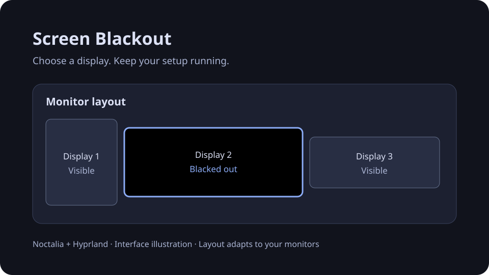

# Screen Blackout for Noctalia

Black out selected Hyprland displays from a compact monitor map, while keeping
them connected and powered on. Hover the bar button, then choose a screen.



*Illustration only. The actual monitor layout follows your connected displays.*

| Plugin | Value |
| --- | --- |
| ID | `magnus/screen-blackout` |
| Version | `1.4.13` |
| Bar entry | `magnus/screen-blackout:toggle` |
| Panel entry | `magnus/screen-blackout:picker` |
| Noctalia plugin API | `34` or later |
| Licence | MIT for original project files; see third-party notices |

## Features

- A monitor map derived from current positions, scale and rotation.
- Left-click to toggle a display; right-click to black out other displays.
- Right-click the same display again to restore every display.
- Batch **Black out all** and **Restore all** controls.
- A compact picker above the blackouts, accessible when every display is covered.
- Pointer/touch shielding to prevent clicks and taps reaching apps underneath.
- Cursor auto-hide after one second of inactivity over blacked-out displays.
- A single opaque pixel per layer, no periodic idle layer polling, and local
  cursor checks that spawn no child commands.

## Requirements

Runtime:

- Linux with pidfds/signalfd support; kernel 5.3 or later.
- Hyprland 0.55 or later **using Lua configuration** and its `hl.config` API.
- Noctalia v5.3 or later supporting plugin API 34. The legacy v4/Quickshell shell
  is a separate product and does not run this plugin.
- Python 3.11 or later (`python3`) and coreutils `sleep` on PATH.
- Wayland layer-shell and stable viewporter support, provided by Hyprland.

Build:

- A C compiler, Bash, `pkg-config`, `wayland-scanner`, the Wayland client
  development library, and the `wayland-protocols` development package.
- No Python packages from PyPI are required.

Build packages on Arch/CachyOS:

```sh
sudo pacman -Syu --needed base-devel wayland wayland-protocols python
```

Build packages on Debian 12+/Ubuntu 24.04+:

```sh
sudo apt-get update
sudo apt-get install build-essential pkg-config libwayland-dev wayland-protocols python3
```

Install a suitable Noctalia and Hyprland session separately. Runtime behavior
was validated on CachyOS/Arch with Noctalia 5.3.0, Hyprland 0.56.2 and Python
3.14. Compiler and regression checks are included in CI; other desktop setups
have not been tested live by the maintainer.
Multiple concurrent Hyprland sessions under one Unix user are currently unsupported.

## Install

Clone or download this repository, then run from its root as your regular user:

```sh
git clone https://github.com/magnusmk2/noctalia-screen-blackout.git
cd noctalia-screen-blackout
./install.sh
noctalia msg plugins enable magnus/screen-blackout
```

The installer builds the native helper locally and installs into
`$NOCTALIA_DATA_HOME/plugins/magnus-screen-blackout`, or the corresponding
`$XDG_DATA_HOME/noctalia/plugins/` directory. The usual destination is
`~/.local/share/noctalia/plugins/magnus-screen-blackout/`.

Add the Screen Blackout widget to a bar in Noctalia. For a manual config, the
widget definition is:

```toml
[widget.screen_blackout]
type = "magnus/screen-blackout:toggle"
```

Add `screen_blackout` to your bar's widget list using your normal Noctalia bar
configuration. See the [Noctalia bar documentation](https://docs.noctalia.dev/noctalia/bar/).
The installer does not edit configuration, enable widgets, or install keybinds.

Configure and verify a recovery shortcut before using all-monitor blackout.
For the default installation path, add these optional bindings to your
Hyprland **Lua** config:

```lua
hl.bind("SUPER + F12", hl.dsp.exec_cmd("noctalia msg panel-toggle magnus/screen-blackout:picker"))
hl.bind("SUPER + SHIFT + F12", hl.dsp.exec_cmd('python3 "$HOME/.local/share/noctalia/plugins/magnus-screen-blackout/blackout.py" restore-all'))
```

Adjust the recovery path if you use a custom data directory. Confirm that the
chosen keys do not replace bindings you need.

For a custom installation root or an update:

```sh
./install.sh --data-home /path/to/noctalia-data
# Disable the existing plugin before replacing it:
./install.sh --replace
```

Existing installations are never overwritten implicitly. `--replace` checks
the plugin identity, builds the new copy first, runs recovery for the old copy,
and preserves it under the data directory's `screen-blackout-backups/` folder.

## Usage and recovery

Hover the bar icon and move into the picker below it. The picker stays open
while the pointer is over the button or panel, then closes after leaving both.
Left-click a monitor to toggle its blackout. Right-click one to leave it visible
and black out the others; right-click it again to restore all screens, including
ones that were already blacked out before the focus action.

Open the panel from a terminal with its exact entry ID:

```sh
noctalia msg panel-toggle magnus/screen-blackout:picker
```

A terminal in the same graphical session can list and restore outputs even
when the picker is unavailable. For the default installation:

```sh
python3 ~/.local/share/noctalia/plugins/magnus-screen-blackout/blackout.py list
python3 ~/.local/share/noctalia/plugins/magnus-screen-blackout/blackout.py restore-all
```

Restore All uses the tracked processes and does not first require a working
monitor query. Displays remain connected, with their modes and HDR settings
unchanged. The plugin does not use DPMS.

## Input, privacy and limits

The black layer receives pointer and touch input, so clicks and taps stop there.
It does not move the pointer or take keyboard focus. The picker occupies the
higher overlay layer. Compositor shortcuts and keyboard input continue to work.
Use a session locker such as hyprlock for authentication and access control;
other software may still access applications underneath this visual cover.

A watcher checks pointer position every 200 ms and monitor geometry every
second. It applies a one-second cursor timeout while over a blacked-out display
and restores the user's prior value elsewhere. It stops after the last blackout.
Requests use a local Hyprland Unix socket with a one-second timeout. The plugin
makes no internet requests and sends no telemetry. Runtime state and small logs
are kept in `$XDG_RUNTIME_DIR/noctalia-screen-blackout/`; raw pointer coordinates
are not recorded as a history. See [SECURITY.md](SECURITY.md) for the trust model.

Disabling the plugin or normally shutting down Noctalia requests Restore All.
Script reloads preserve blackouts. Keep the independent recovery binding
available for abnormal shell exits.

## Build, test and release

```sh
python3 -B -m unittest discover -s screen-blackout/tests -v
python3 -B -m unittest discover -s tests -v
CFLAGS="-Werror -fanalyzer" screen-blackout/build-helper.sh
python3 -B scripts/check_project.py
python3 -B scripts/release.py
```

`CC` selects a compiler executable. `CFLAGS` and `LDFLAGS` accept additional
space-separated flags. The optional `-fanalyzer` check above requires GCC;
omit that flag with other compilers. Protocol paths come from `pkg-config`. The compiled
helper is replaced atomically, and running older helpers remain identifiable
for recovery. Build products and Python caches are gitignored.

The release command writes a reproducible source archive and SHA-256 checksum
to `dist/`. The archive contains the reviewed source allowlist, with no compiled
executables, caches, logs, local configuration, or desktop captures. It can be
built and installed after extraction.

To publish a GitHub Release, push a `v<version>` tag matching
`screen-blackout/plugin.toml`. The release workflow reruns validation, builds
the source archive and checksum, extracts notes from `CHANGELOG.md`, and
publishes those assets. Its publishing job receives only `contents: write` and
does not check out or execute repository source.

CI uses read-only repository permissions, pinned GitHub-owned actions and no
repository secrets. It checks metadata, licensing/notice presence, publication
contents, regressions, native compilation and source release packaging.

## Uninstall

Restore all screens and disable the plugin first:

```sh
python3 ~/.local/share/noctalia/plugins/magnus-screen-blackout/blackout.py restore-all
noctalia msg plugins disable magnus/screen-blackout
./install.sh --uninstall
```

Use the same `--data-home` if you installed into a custom root. Uninstall checks
the plugin identity, runs recovery and removes only that installation. Remove
the bar widget and optional keybinds you added. Backups are retained separately.

## Repository and community distribution

This repository includes a Noctalia source catalog and `screen-blackout/`
plugin directory. A local path source works after building the helper; the
installer is the supported initial installation route. Registering a remote
Git source alone does not compile its native helper.

The current [Noctalia community store rules](https://github.com/noctalia-dev/community-plugins#what-a-plugin-is-allowed-to-be)
do not accept external helpers that draw UI. This version's native Wayland
layer therefore needs an architectural change before a community-store
submission. It can be distributed independently on GitHub. No affiliation
or endorsement by the Noctalia or Hyprland teams is claimed.

See [publishing notes](docs/PUBLISHING.md) for the reviewed scope and hosting
settings, and [GitHub Actions](https://github.com/magnusmk2/noctalia-screen-blackout/actions)
for current validation results.

## Licence

Original project files use the [MIT licence](LICENSE). The vendored layer-shell
XML retains its original copyright and permission notice, reproduced in
[third-party notices](screen-blackout/THIRD_PARTY_NOTICES.md).
